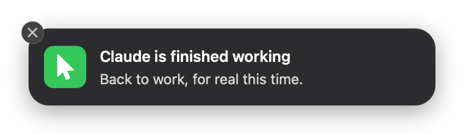

<p align="center"></p>

# Artificially Industrious

*AI, but it stands for Artificially Industrious.*

<p align="center"></p>

Your AI is still working on your prompt, so you are still working. This keeps
your Microsoft Teams and Slack status "Available" while that's true, then stops, and tells
you which tool finished: *"Claude is finished working"*,
*"Copilot is finished working"*.

Works with Claude Code, GitHub Copilot, Cursor, and any command-line AI tool.

macOS only. No npm dependencies. No Microsoft Graph and no Azure setup.

## Setup

You need the Xcode Command Line Tools (`xcode-select --install`).

**1. Get it**

```bash
brew install izkumberdu/tap/artificially-industrious
```

<details>
<summary>Without Homebrew</summary>

Needs Node 20+.

```bash
git clone https://github.com/Izkumberdu/artificially-industrious.git
cd artificially-industrious
npm link
```

</details>

**2. Install the helper**

```bash
industrious install helper
```

This builds **Industrious Nudge.app** into `~/Applications`.

**3. Allow it**

```bash
industrious permission
```

macOS asks to let Industrious Nudge send notifications: click **Allow**. Then,
in System Settings → Privacy & Security → **Accessibility** (called **Device
Control and Data Access** on newer macOS), switch on **Industrious Nudge**. The
command waits until you have.

**4. Connect your AI tool**

Run the line for each tool you use:

| Tool | Command | Hooks go in |
|---|---|---|
| Claude Code (CLI, desktop app, IDE) | `industrious install claude --write` | `~/.claude/settings.json` |
| GitHub Copilot (VS Code agent mode, Copilot CLI) | `industrious install copilot --write` | `~/.copilot/hooks/industrious.json` |
| Cursor | `industrious install cursor --write` | `~/.cursor/hooks.json` |
| Anything else (Codex, Aider, Gemini CLI…) | `industrious run -- codex "fix the tests"` | nothing to install |

Existing settings files are backed up first. Leave out `--write` to preview
the change. `industrious run` wraps any command and stays Available until it
exits.

That's it. Send a prompt and run `industrious status` to see it working.

## How it works

```
prompt sent  ──► industrious hook start ──► keeper starts
                                              │  every 60s: Industrious Nudge
                                              │  moves the mouse by 0 pixels
prompt done  ──► industrious hook stop  ──► "<Tool> is finished working"
                                              └─ nothing left running? keeper exits
```

- While a task is running, a background keeper launches Industrious Nudge once a
  minute. macOS counts its zero-distance mouse move as activity, so Teams and
  Slack keep you Available. Any app that checks how long your Mac has been idle
  does the same.
- The keeper only runs while something is working, and exits on its own when
  nothing is.
- A task older than 2 hours counts as crashed and is dropped, so a dead tool
  can't keep you Available forever.
- Each time a tool finishes, you get a notification naming it: *"Claude is
  finished working. Back to work, for real this time."*

## The nudge helper

Moving the mouse, even by zero pixels, needs macOS's Accessibility permission.
That permission is powerful: an app that has it can type and click anywhere.

So it goes to one small, single-purpose app: **Industrious Nudge**, about 50
lines of Swift (`helper/main.swift`). It does two things, then quits: post one
mouse move at the cursor's current position, and show the "finished working"
notification. Industrious Nudge is the only app that needs the permission.

**Tested:** in a 6½-minute hands-off test, the system idle timer never went past
about 60 seconds. Without the nudge (`caffeinate` alone), it climbed past 400
seconds, and Teams marks you Away after about 5 minutes.

Check it yourself while a task runs and you're hands-off:

```bash
ioreg -c IOHIDSystem | awk '/HIDIdleTime/ {print int($NF/1e9) "s idle"; exit}'
```

## Commands

```
industrious status                    running tasks, keeper and helper state
industrious permission                ask macOS to allow Industrious Nudge
industrious install helper            (re)build Industrious Nudge.app
industrious install claude --write    add the Claude Code hooks
industrious install copilot --write   add the GitHub Copilot hooks
industrious install cursor --write    add the Cursor hooks
industrious run -- <command>          stay Available while any command runs
industrious start|stop [id] [tool]    manual control
industrious mode [both|nudge|caffeinate]
industrious uninstall                 remove hooks, helper app and state
```

Config lives in `~/.industrious/config.json`: `mode` (default `both`: nudge,
plus `caffeinate` so the screen doesn't sleep), `intervalSeconds`,
`timeoutMinutes`, `notifyWhenDone`. The keeper's log is
`~/.industrious/keeper.log`.

## Troubleshooting

**`industrious status` says the helper has no permission after a rebuild.**
macOS ties the permission to the exact build, so the old entry can still look
switched on while macOS ignores it. Remove **Industrious Nudge** from the list
with **−**, run `industrious permission`, and switch on the new entry. Don't
add it yourself with **+**: an entry added that way doesn't match the helper.

**Notifications show a blank icon.** macOS cached the icon from an older build.
Run `killall usernoted NotificationCenter`; both restart on their own.

**Hooks stopped working after switching Node versions.** The hooks call the
exact `node` binary you installed them with. Run the `install` command for
your tool again.

**Copilot isn't detected.** Copilot's hooks are a preview feature in VS Code.
Make sure the chat is using Copilot agent mode, and check that
`~/.copilot/hooks/industrious.json` exists.

## Uninstall

```bash
industrious uninstall
```

This removes the hooks from Claude Code, Copilot and Cursor (leaving your other
hooks alone, with a backup of each settings file), stops the keeper, moves
Industrious Nudge.app to the Trash, and deletes `~/.industrious`.

It then prints the commands to finish by hand: one to reset the helper's macOS
permissions, then `brew uninstall artificially-industrious` (or, for a clone,
`npm rm -g` and deleting the project folder).

> **Just deleting the app isn't enough.** The hooks live in your AI tools'
> settings, so they keep running. Without the app, Teams and Slack mark you Away again;
> without the `industrious` command, every prompt shows a hook error. Run
> `industrious uninstall` first.
>
> macOS also remembers the helper's permission after the app is gone, so a
> reinstall usually skips the permission step. Reset it with the `tccutil`
> command above for a true clean slate.

## Development

```bash
npm test
```

Set `INDUSTRIOUS_HOME` to a temp folder so testing doesn't touch your real state.

## License

[MIT](LICENSE)
